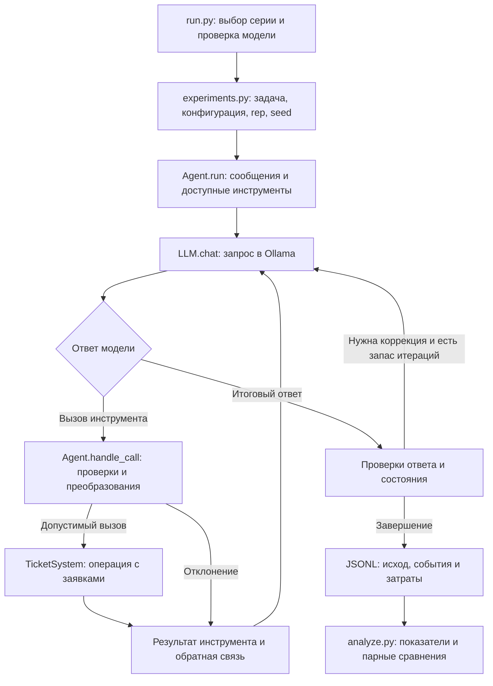

# Карта проекта

Стенд состоит из агента, имитационной системы заявок и экспериментальной обвязки. Агент вызывает модель через Ollama; инструменты работают с локальным состоянием `TicketSystem`. Каждый запуск создаёт новое состояние системы. После завершения ответ и состояние сопоставляются с критериями задачи.

## Порядок чтения

1. [experiments.py](../experiments.py) — какие задачи и конфигурации входят в каждую серию, как вычисляется seed.
2. [Agent.run()](../src/agent.py#L433) — как формируется запрос, вызывается модель и обрабатывается её ответ.
3. [Agent.handle_call()](../src/agent.py#L234) — где применяются проверки и выполняется инструмент.
4. [TicketSystem](../src/ticket_system.py#L72) — что именно происходит с заявками при вызове инструмента.
5. [Task](../src/task_types.py#L12), [критерии задач](../src/tasks.py) и [analyze.py](../analyze.py) — как определяется успех и рассчитываются показатели.

## Один запуск

При исчерпании лимитов запуск также завершается и получает итоговую оценку. Схема показывает основной путь; подробный порядок проверок задан в `Agent.run()` и `Agent.handle_call()`.

## Модули

| Файл | Ответственность |
|---|---|
| [run.py](../run.py) | Командная строка, проверка модели, манифест, возобновление и запись результатов |
| [experiments.py](../experiments.py) | Расписания шести серий, выбранные конфигурации и коррекция H05 |
| [src/agent.py](../src/agent.py) | Цикл агента, механизмы контроля, события ошибок и трасса выполнения |
| [src/configs.py](../src/configs.py) | Флаги механизмов, комбинации, абляции и лимиты итераций |
| [src/llm.py](../src/llm.py) | Клиент Ollama `/api/chat`, параметры генерации и учёт токенов |
| [src/raw_llm.py](../src/raw_llm.py) | Шаблон Qwen3 и диагностика некорректного вызова через `/api/generate` |
| [src/tools.py](../src/tools.py) | Описания и схемы инструментов, валидация, нормализация, правила перехода статусов |
| [src/ticket_system.py](../src/ticket_system.py) | Начальные заявки, справочники, операции и внедрение сбоев |
| [src/__init__.py](../src/__init__.py) | Объявление пакета; внутренние импорты не зависят от рабочего каталога |
| [src/task_types.py](../src/task_types.py) | Общий тип `Task`, схемы ответов и вспомогательная функция для всех наборов |
| [src/tasks.py](../src/tasks.py) | Задачи T1–T12, критерии ответа и состояния, сборка набора из 36 задач |
| [src/tasks_variants.py](../src/tasks_variants.py) | Ещё 24 варианта исходных задач |
| [src/holdout_tasks.py](../src/holdout_tasks.py) | Задачи H01–H12 и эталонные последовательности для проверки стенда |
| [analyze.py](../analyze.py) | Показатели надёжности и затрат, критерий знаков, устойчивость при пяти seed |
| [export_materials.py](../export_materials.py) | Выгрузка фактических промптов, схем и примеров запросов из кода |
| [tests/test_reproduction.py](../tests/test_reproduction.py) | Проверка расписаний, эталонов, H05, статистики, выгрузки и возобновления |
| [tests/test_imports.py](../tests/test_imports.py) | Независимый импорт модулей и запуск корневых скриптов из другой рабочей папки |

## Механизмы контроля

Все механизмы включаются флагами `AgentConfig`. В таблице указаны ключи отдельных конфигураций статьи; комбинации задаются в том же файле.

| Механизм / ключ | Где реализован | Что делает |
|---|---|---|
| Контроль данных / `data2` | `tools.validate_args()`, `tools.check_value()`, `Agent.answer_problems()`, `Agent.diagnose_malformed_call()` | Проверяет параметры и ответ; сообщает конкретную причину отклонения; диагностирует некорректный вызов |
| Детерминированные функции / `det_rules2` | `tools.normalize()`, `tools.transition_rule()`, `Agent.policy_violation()`, `Agent.handle_call()`, `find_similar_open()`, `keyword_search()` | Нормализует значения, проверяет регламент и дубликаты, собирает страницы поиска, выполняет резервный поиск |
| Ограничение инструментов / `tools` | `Agent.__init__()`, `Agent.policy_violation()` | Формирует список из `task.allowed_tools` и отклоняет недоступный инструмент |
| Верификация / `verify` | `Agent.post_verify()`, `Agent.llm_verify()`, `Agent.run()` | Сверяет состояние после изменения; проверяет итоговый ответ той же моделью |
| Контроль выполнения / `monitor` | `Agent.loop_violation()`, `Agent.handle_call()`, `Agent.run()` | Ограничивает повторы и итерации, повторяет временные отказы, требует проверки после неполного ответа |
| Подтверждение / `confirm` | Ветка `cfg.confirm` в `Agent.handle_call()` | Имитирует подтверждение критических операций пользователем, знающим цель задачи |

В `configs.py` сохранены промежуточные конфигурации разработки. Десять конфигураций основной серии перечислены в `experiments.MAIN_KEYS`; при запуске серии используются именно они. Отдельная конфигурация `tools` ограничивает набор инструментов, а правила регламента в конфигурациях статьи входят в ДФ. Общие ДФ без двух специальных компонентов определены как `experiments.GENERAL`. Абляции отключают компоненты через `AgentConfig.ablate` и флаг `rules_v2`.

## Где находится эталон

`Task.prompt` передаётся модели. `answer_schema` и `answer_example` описывают ожидаемый формат. Функции `answer_ok` и `state_ok` проверяют ответ и конечное состояние; `expected` и `requires_observation` используются при разметке действий. `faults` задаёт сбои, `extra_tickets` — дополнительные записи конкретной задачи.

Эталонная разметка выполняется в `Agent.judge_call()`; событие добавляет `Agent.add_event()`. Она нужна для измерений и имитации подтверждения. Эталонные функции не передаются модели текстом. Однако часть механизмов использует сведения о задаче: например, ограничение инструментов опирается на `allowed_tools`, а подтверждение — на эталонную оценку действия. Это имитационный стенд с явно заданными критериями.

`REFERENCE_RUNS` в отложенном наборе содержит правильные последовательности для автономной проверки эталонов. Эти последовательности не передаются агенту при модельных запусках. Исправление H05 применяется в `experiments.py`; история изменения описана в [протоколе](protocol.md#h05).

## Код и выгруженные материалы

| Материал | Источник |
|---|---|
| `prompts/system.txt` и дополнительные инструкции | Константы `SYSTEM_PROMPT`, `PROMPT_DET`, `PROMPT_RESTRICT`, `PROMPT_CONFIRM` в `agent.py` |
| `prompts/tasks.json` | Запросы и параметры `Task` для 36 исходных и 12 отложенных задач |
| `prompts/initial_request_example.json` | Начальные сообщения и инструменты, собранные `Agent.run()` для T1 в полной конфигурации |
| `prompts/verifier_example.json` | Пример запроса, сформированного `Agent.llm_verify()` |
| `docs/tool_schemas.json` | Схемы, передаваемые модели через `tools.to_ollama()` |

Шаблоны динамической обратной связи находятся непосредственно в `Agent.run()`, `Agent.handle_call()` и `Agent.llm_verify()`. Полные внутренние схемы валидации заданы в `tools.ALL_SPECS`; их отдельная выгрузка не требуется для запуска.

Выгрузки служат для чтения и проверки. Агент использует определения из `src/`; изменение файла в `prompts/` само по себе не меняет поведение запуска. Для обновления выгрузок после изменения кода используется `python -B export_materials.py`.

## Как проверить результат

Для знакомства с числами статьи откройте [analysis/tables.csv](../analysis/tables.csv). Для просмотра отдельного запуска найдите строку по `task`, `config`, `rep` в соответствующем файле [results/](../results/). Поле `trace` показывает вызовы и результаты, `events` — разметку ошибок, `success` — итоговую успешность.

Команда `python -B analyze.py` пересчитывает показатели из опубликованных журналов. Команда `python -B -m unittest discover -s tests -v` проверяет эталоны и соответствие ключевых результатов статье. Для обеих команд модель не требуется. Начать новый модельный запуск можно по [инструкции в README](../README.md#новые-запуски).
